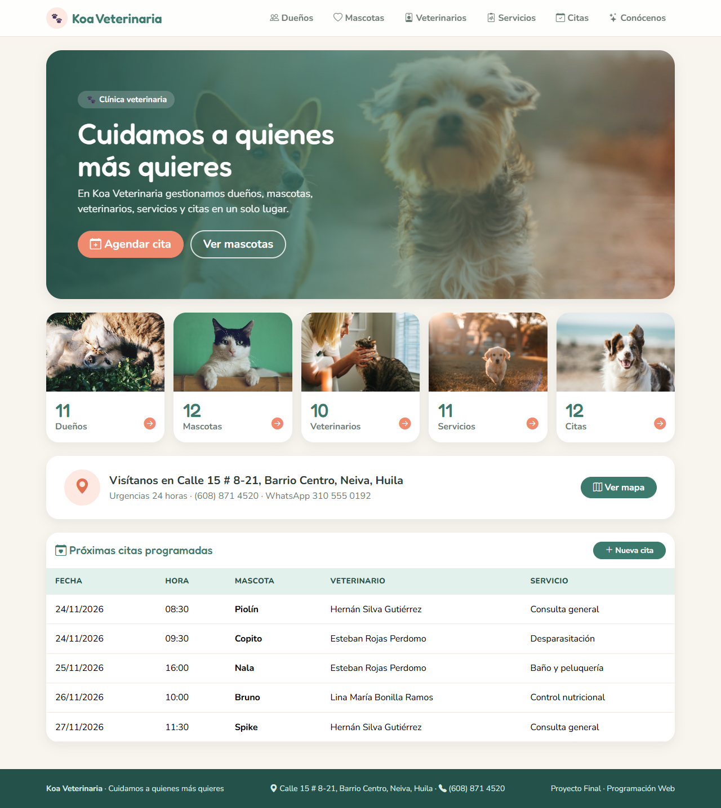
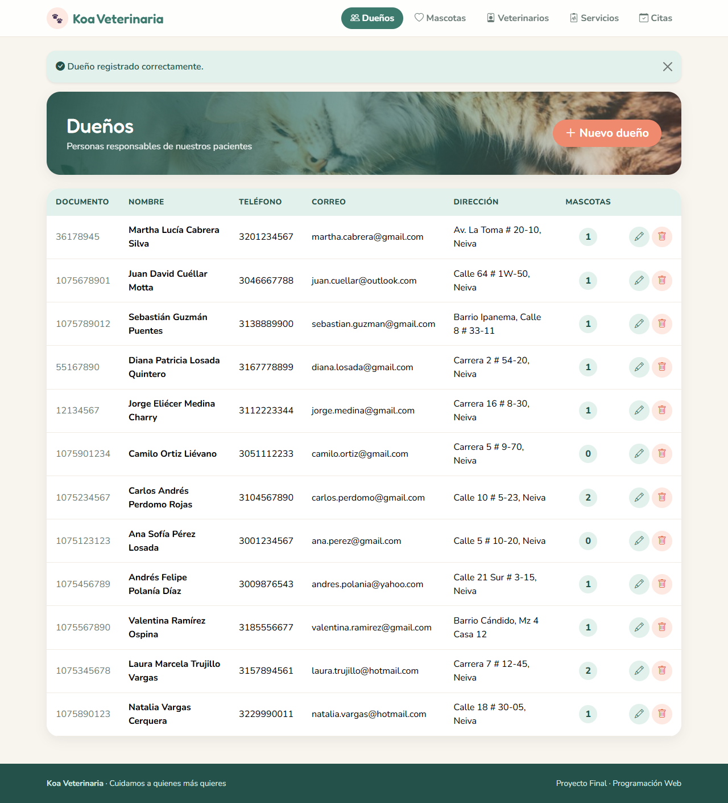
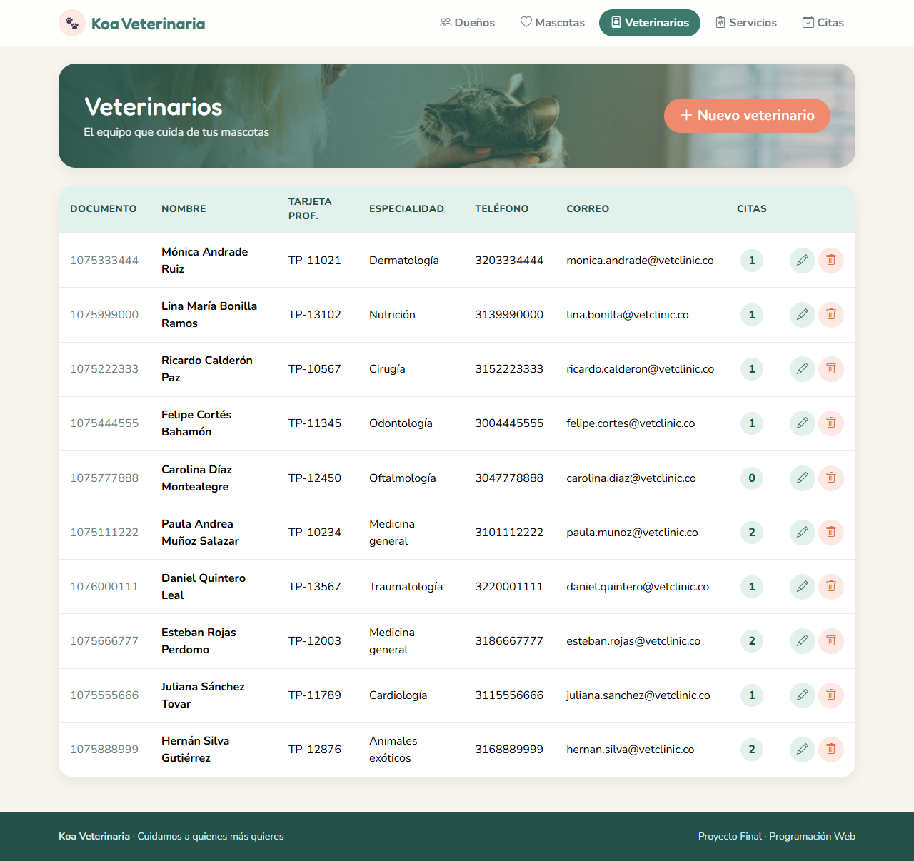
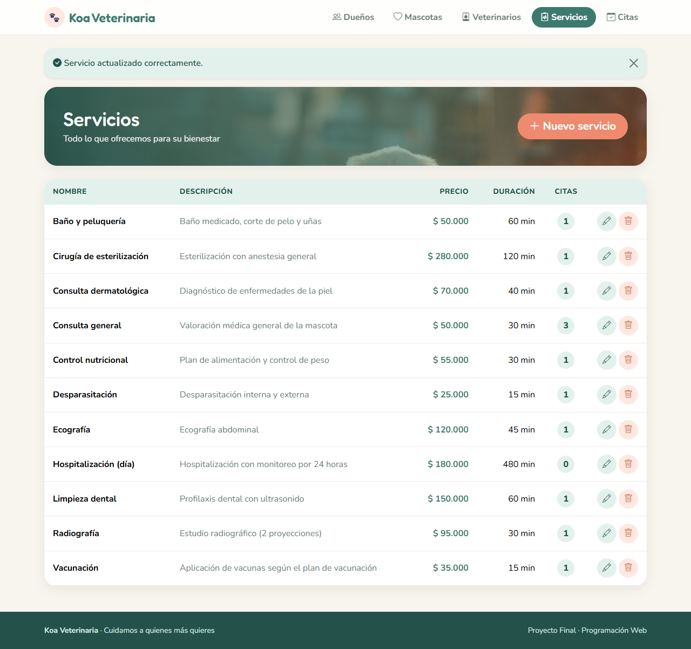
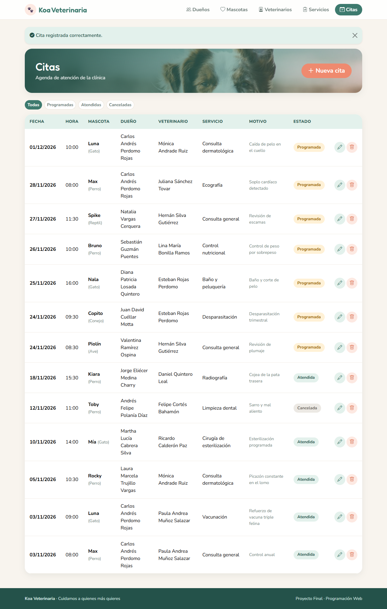
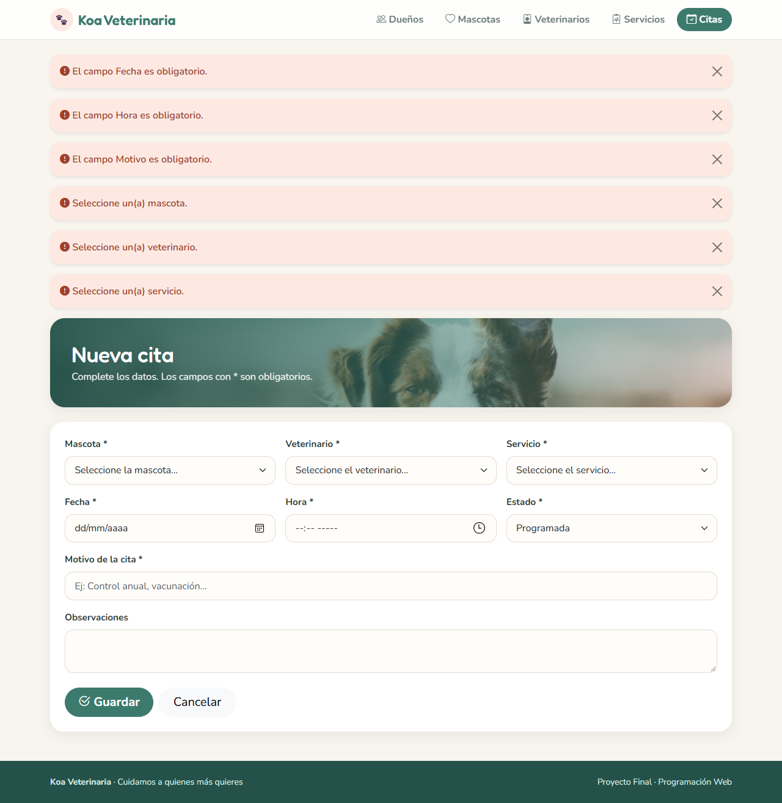
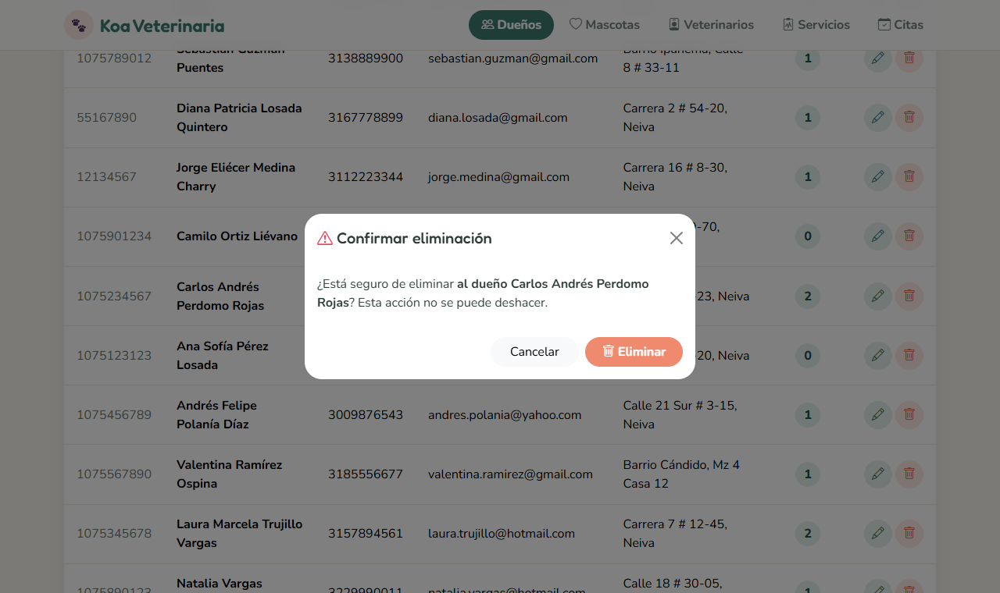
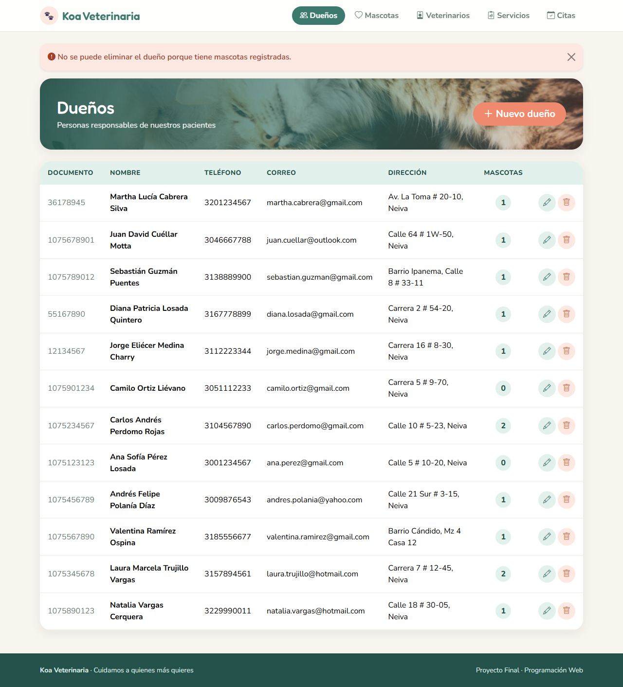
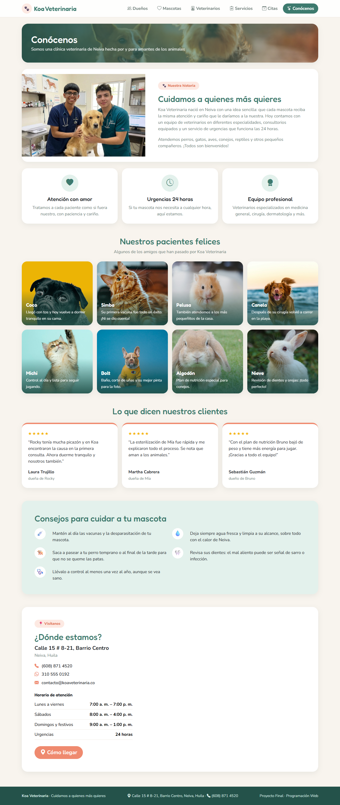

# koa-veterinaria-Neiva

**Proyecto final de Programación Web**: aplicación web CRUD desarrollada con Flask y PostgreSQL para administrar una clínica veterinaria en Neiva, Huila.

## Integrantes

| Nombre | Codigo |
|---|---|
| Samuel Ramos Acuña | 20251233811 |
| Mario Hernan García Perdomo | 20242228996 |

**Curso:** Programación Web
**Docente:** Jose Miguel Llanos Mosquera
**Fecha de entrega:** 21 de noviembre de 2026


## Descripción del tema

**Koa Veterinaria** es una clínica veterinaria que necesita un sistema para organizar su información diaria. La aplicación permite gestionar:

| Módulo | Qué guarda |
|---|---|
| **Dueños** | Las personas responsables de las mascotas: documento, nombre, teléfono, correo y dirección. |
| **Mascotas** | Los pacientes de la clínica. Cada mascota pertenece a un dueño. |
| **Veterinarios** | Los profesionales de la clínica, con su tarjeta profesional y su especialidad. |
| **Servicios** | El catálogo de servicios (consulta, vacunación, cirugía, etc.) con su precio y duración. |
| **Citas** | La agenda de atención: une una **mascota**, un **veterinario** y un **servicio** en una fecha y hora. |

La tabla **citas** es la tabla de movimientos del proyecto, con **tres llaves foráneas** (`id_mascota`, `id_veterinario` e `id_servicio`).

### Funcionalidades

-  **CRUD completo** (listar, crear, editar y eliminar) de las 5 tablas.
-  Los listados muestran los **nombres** de los datos relacionados, no solo los ID.
-  Las llaves foráneas se escogen con **listas desplegables**.
-  **Validación de los formularios en el servidor** con mensajes claros.
-  **Manejo de errores** de la base de datos sin que la aplicación falle: valores duplicados, eliminar un registro con datos relacionados y un veterinario con dos citas a la misma hora.
-  **Confirmación antes de eliminar** (ventana modal).
-  **Consultas SQL parametrizadas** (protección contra inyección SQL).
-  Página de inicio con totales y próximas citas, y filtro de citas por estado.
-  Página **Conócenos** con galería, mensajes de clientes, consejos y la **ubicación de la clínica en un mapa de Neiva**.


## Modelo Entidad-Relación

<!-- 📸 Imagen del MER (ya está en docs/MER.png) -->


**Relaciones:**

| Relación | Cardinalidad |
|---|---|
| Un **dueño** tiene muchas **mascotas** | 1 : N |
| Una **mascota** tiene muchas **citas** | 1 : N |
| Un **veterinario** atiende muchas **citas** | 1 : N |
| Un **servicio** se incluye en muchas **citas** | 1 : N |

### Documentación

| Documento | Contenido |
|---|---|
| [Diccionario de datos](docs/diccionario_datos.md) | Campos, tipos de dato y restricciones (PK, FK, NOT NULL, UNIQUE, CHECK) de cada tabla |
| [Normalización](docs/normalizacion.md) | Por qué cada tabla cumple 1FN, 2FN y 3FN |
| [Plan de pruebas](docs/plan_pruebas.md) | 18 casos de prueba con resultado y captura de evidencia |
| [Guía del código](docs/guia_del_codigo.md) | Para qué sirve cada archivo y cómo funciona la aplicación |
| [Backup de la base de datos](database/backup.sql) | Copia de seguridad generada con `pg_dump` |


## Tecnologías

| Tecnología | Uso |
|---|---|
| Python 3 + Flask | Servidor web y rutas (un Blueprint por tabla) |
| PostgreSQL + psycopg2 | Base de datos y conexión desde Python |
| Jinja2 | Plantillas HTML con herencia (`base.html`) |
| Bootstrap 5 | Diseño de la interfaz |
| python-dotenv | Lectura de las credenciales desde `.env` |
| pytest | Pruebas automatizadas |
| Git y GitHub | Control de versiones |


## Estructura del proyecto

```
koa-veterinaria-Neiva/
├── app.py               # Punto de entrada de Flask
├── config.py            # Lectura de la configuración (.env) y datos de la clínica
├── db.py                # Conexión a PostgreSQL y manejo de errores
├── validaciones.py      # Validación de formularios en el servidor
├── routes/              # Un Blueprint por tabla
│   ├── duenos.py
│   ├── mascotas.py
│   ├── veterinarios.py
│   ├── servicios.py
│   ├── citas.py
│   └── nosotros.py      # Página Conócenos
├── templates/           # Plantillas Jinja2 (base.html + una carpeta por tabla)
├── static/              # CSS, JS e imágenes
├── database/
│   ├── schema.sql       # Creación de las 5 tablas
│   ├── datos.sql        # Carga de datos (10 o más registros por tabla)
│   ├── crear_bd.py      # Crea la base de datos y ejecuta los dos scripts
│   └── backup.sql       # Backup generado con pg_dump
├── docs/                # MER, diccionario, normalización, plan de pruebas y evidencias
├── tests/               # Pruebas automatizadas con pytest
├── requirements.txt
├── .env.example
└── .gitignore
```


## Instalación y ejecución

### Requisitos previos

- [Python 3.10 o superior](https://www.python.org/downloads/) (al instalarlo, marcar **"Add Python to PATH"**)
- [PostgreSQL](https://www.postgresql.org/download/) (con pgAdmin 4)
- [Git](https://git-scm.com/downloads)

### Paso 1. Clonar el repositorio

```powershell
git clone https://github.com/mariocrack20054-prog/koa-veterinaria-Neiva.git
cd koa-veterinaria-Neiva
```

### Paso 2. Crear el entorno virtual e instalar las dependencias

```powershell
python -m venv .venv
.venv\Scripts\activate
pip install -r requirements.txt
```

> Si PowerShell no deja activar el entorno, ejecutar primero:
> `Set-ExecutionPolicy -Scope CurrentUser RemoteSigned`

### Paso 3. Configurar la conexión a la base de datos

Copiar el archivo de ejemplo:

```powershell
copy .env.example .env
```

Abrir `.env` con el Bloc de notas y escribir la contraseña de PostgreSQL en `DB_PASSWORD`:

```
DB_HOST=localhost
DB_PORT=5432
DB_NAME=veterinaria
DB_USER=postgres
DB_PASSWORD=la_contraseña_de_postgres
```

### Paso 4. Crear la base de datos

**Opción A: con el script** (crea la base de datos `veterinaria`, las tablas y los datos):

```powershell
python database/crear_bd.py
```

**Opción B: restaurando el backup en pgAdmin 4**
1. Crear una base de datos vacía llamada `veterinaria`.
2. Clic derecho sobre ella → **Query Tool** → abrir `database/backup.sql` → ejecutar (▶).

### Paso 5. Ejecutar la aplicación

```powershell
python app.py
```

Abrir en el navegador: **http://localhost:5000**

### Paso 6 (opcional). Ejecutar las pruebas automatizadas

```powershell
pytest -v
```

---

## Capturas de la aplicación

### Página de inicio
<!-- 📸 Captura de la página de inicio -->


### Dueños: listar y crear
<!-- 📸 Listado de dueños después de crear uno nuevo (mensaje verde de éxito) -->


### Mascotas: listado con el nombre del dueño
<!-- 📸 Listado de mascotas: se ve el NOMBRE del dueño, no el ID -->


### Mascotas: editar con el formulario precargado
<!-- 📸 Formulario de edición con los datos ya cargados -->


### Veterinarios
<!-- 📸 Listado de veterinarios -->


### Servicios
<!-- 📸 Listado de servicios después de editar uno -->


### Citas: listado con las tres llaves foráneas
<!-- 📸 Listado de citas con mascota, dueño, veterinario y servicio por nombre -->


### Validación de formularios en el servidor
<!-- 📸 Formulario enviado vacío: mensajes de campos obligatorios -->


### Valor duplicado
<!-- 📸 Intento de registrar un correo que ya existe -->


### Confirmación antes de eliminar
<!-- 📸 Ventana modal que pregunta antes de eliminar -->


### Error controlado al eliminar un registro relacionado
<!-- 📸 Mensaje "No se puede eliminar..." al borrar un dueño con mascotas -->


### Página Conócenos y ubicación en Neiva
<!-- 📸 Galería, mensajes de clientes y mapa con la ubicación -->

