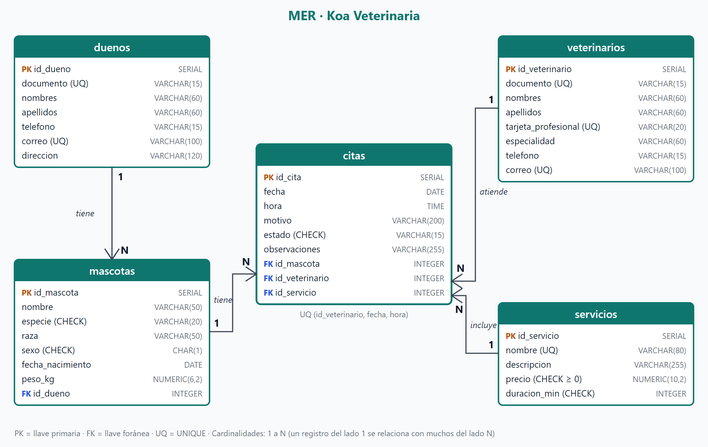

# koa-veterinaria-Neiva

**Proyecto final de Programación Web**: aplicación web CRUD desarrollada con Flask y PostgreSQL para administrar una clínica veterinaria en Neiva, Huila.

## Integrantes

| Nombre | Codigo |
|---|---|
| Samuel Ramos Acuña | 20251233811 |
| Mario Hernan García Perdomo | 20242228996 |

**Curso:** Programación Web
**Docente:** Jose Miguel Llanos Mosquera
**Fecha de entrega:** 21 de noviembre de 2026

## Descripción del tema

**Koa Veterinaria** es una clínica veterinaria que necesita un sistema para organizar su información diaria. La aplicación permite gestionar:

| Módulo | Qué guarda |
|---|---|
| **Dueños** | Las personas responsables de las mascotas: documento, nombre, teléfono, correo y dirección. |
| **Mascotas** | Los pacientes de la clínica. Cada mascota pertenece a un dueño. |
| **Veterinarios** | Los profesionales de la clínica, con su tarjeta profesional y su especialidad. |
| **Servicios** | El catálogo de servicios (consulta, vacunación, cirugía, etc.) con su precio y duración. |
| **Citas** | La agenda de atención: une una **mascota**, un **veterinario** y un **servicio** en una fecha y hora. |

La tabla **citas** es la tabla de movimientos del proyecto, con **tres llaves foráneas** (`id_mascota`, `id_veterinario` e `id_servicio`).

### Funcionalidades

-  **CRUD completo** (listar, crear, editar y eliminar) de las 5 tablas.
-  Los listados muestran los **nombres** de los datos relacionados, no solo los ID.
-  Las llaves foráneas se escogen con **listas desplegables**.
-  **Validación de los formularios en el servidor** con mensajes claros.
-  **Manejo de errores** de la base de datos sin que la aplicación falle: valores duplicados, eliminar un registro con datos relacionados y un veterinario con dos citas a la misma hora.
-  **Confirmación antes de eliminar** (ventana modal).
-  **Consultas SQL parametrizadas** (protección contra inyección SQL).
-  Página de inicio con totales y próximas citas, y filtro de citas por estado.
-  Página **Conócenos** con galería, mensajes de clientes, consejos y la **ubicación de la clínica en un mapa de Neiva**.

## Modelo Entidad-Relación

<!-- 📸 Imagen del MER (ya está en docs/MER.png) -->

**Relaciones:**

| Relación | Cardinalidad |
|---|---|
| Un **dueño** tiene muchas **mascotas** | 1 : N |
| Una **mascota** tiene muchas **citas** | 1 : N |
| Un **veterinario** atiende muchas **citas** | 1 : N |
| Un **servicio** se incluye en muchas **citas** | 1 : N |

### Documentación

| Documento | Contenido |
|---|---|
| [Diccionario de datos](docs/diccionario_datos.md) | Campos, tipos de dato y restricciones (PK, FK, NOT NULL, UNIQUE, CHECK) de cada tabla |
| [Normalización](docs/normalizacion.md) | Por qué cada tabla cumple 1FN, 2FN y 3FN |
| [Plan de pruebas](docs/plan_pruebas.md) | 18 casos de prueba con resultado y captura de evidencia |
| [Guía del código](docs/guia_del_codigo.md) | Para qué sirve cada archivo y cómo funciona la aplicación |
| [Backup de la base de datos](database/backup.sql) | Copia de seguridad generada con `pg_dump` |

## Tecnologías

| Tecnología | Uso |
|---|---|
| Python 3 + Flask | Servidor web y rutas (un Blueprint por tabla) |
| PostgreSQL + psycopg2 | Base de datos y conexión desde Python |
| Jinja2 | Plantillas HTML con herencia (`base.html`) |
| Bootstrap 5 | Diseño de la interfaz |
| python-dotenv | Lectura de las credenciales desde `.env` |
| pytest | Pruebas automatizadas |
| Git y GitHub | Control de versiones |

