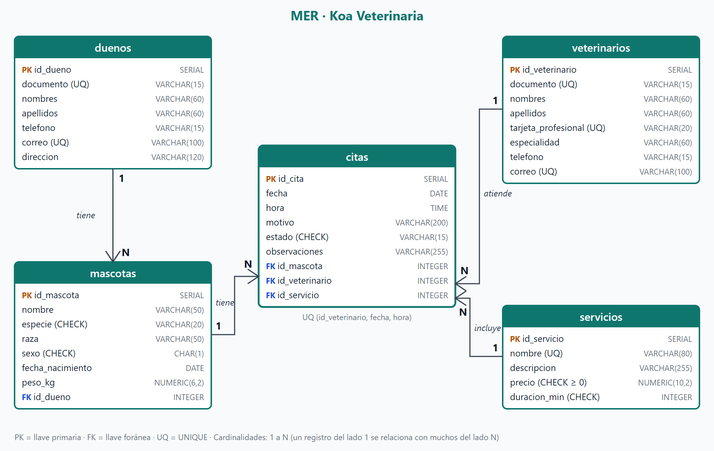

# Diccionario de datos · Koa Veterinaria

Base de datos: **veterinaria** (PostgreSQL). Script de creación: [`database/schema.sql`](../database/schema.sql).

## Relaciones

| Relación | Cardinalidad | Llave foránea | Regla al eliminar |
|---|---|---|---|
| duenos → mascotas | 1 : N (un dueño tiene muchas mascotas; cada mascota tiene un dueño) | `mascotas.id_dueno` | RESTRICT |
| mascotas → citas | 1 : N | `citas.id_mascota` | RESTRICT |
| veterinarios → citas | 1 : N | `citas.id_veterinario` | RESTRICT |
| servicios → citas | 1 : N | `citas.id_servicio` | RESTRICT |

`citas` es la tabla transaccional con **tres llaves foráneas**. Con `ON DELETE RESTRICT` no se puede borrar un dueño, mascota, veterinario o servicio que tenga registros relacionados; la aplicación muestra un mensaje en ese caso.

---

## 1. duenos
Personas propietarias de las mascotas.

| Campo | Tipo | Restricciones | Descripción |
|---|---|---|---|
| id_dueno | SERIAL | PK | Identificador del dueño |
| documento | VARCHAR(15) | NOT NULL, UNIQUE, CHECK (solo dígitos, 6 a 15) | Número de documento de identidad |
| nombres | VARCHAR(60) | NOT NULL | Nombres del dueño |
| apellidos | VARCHAR(60) | NOT NULL | Apellidos del dueño |
| telefono | VARCHAR(15) | NOT NULL | Teléfono de contacto |
| correo | VARCHAR(100) | NOT NULL, UNIQUE, CHECK (formato de correo) | Correo electrónico |
| direccion | VARCHAR(120) | — (opcional) | Dirección de residencia |

## 2. veterinarios
Profesionales que atienden las citas.

| Campo | Tipo | Restricciones | Descripción |
|---|---|---|---|
| id_veterinario | SERIAL | PK | Identificador del veterinario |
| documento | VARCHAR(15) | NOT NULL, UNIQUE, CHECK (solo dígitos, 6 a 15) | Documento de identidad |
| nombres | VARCHAR(60) | NOT NULL | Nombres |
| apellidos | VARCHAR(60) | NOT NULL | Apellidos |
| tarjeta_profesional | VARCHAR(20) | NOT NULL, UNIQUE | Número de tarjeta profesional |
| especialidad | VARCHAR(60) | NOT NULL | Área de especialidad |
| telefono | VARCHAR(15) | NOT NULL | Teléfono de contacto |
| correo | VARCHAR(100) | NOT NULL, UNIQUE, CHECK (formato de correo) | Correo institucional |

## 3. servicios
Catálogo de servicios que ofrece la clínica.

| Campo | Tipo | Restricciones | Descripción |
|---|---|---|---|
| id_servicio | SERIAL | PK | Identificador del servicio |
| nombre | VARCHAR(80) | NOT NULL, UNIQUE | Nombre del servicio |
| descripcion | VARCHAR(255) | — (opcional) | Descripción del servicio |
| precio | NUMERIC(10,2) | NOT NULL, CHECK (precio >= 0) | Precio en pesos colombianos |
| duracion_min | INTEGER | NOT NULL, CHECK (entre 5 y 480) | Duración estimada en minutos |

## 4. mascotas
Animales registrados en la clínica.

| Campo | Tipo | Restricciones | Descripción |
|---|---|---|---|
| id_mascota | SERIAL | PK | Identificador de la mascota |
| nombre | VARCHAR(50) | NOT NULL | Nombre de la mascota |
| especie | VARCHAR(20) | NOT NULL, CHECK (Perro, Gato, Ave, Conejo, Reptil, Otro) | Especie |
| raza | VARCHAR(50) | — (opcional) | Raza |
| sexo | CHAR(1) | NOT NULL, CHECK ('M' macho, 'H' hembra) | Sexo |
| fecha_nacimiento | DATE | CHECK (no puede ser futura) | Fecha de nacimiento (opcional) |
| peso_kg | NUMERIC(6,2) | CHECK (peso_kg > 0) | Peso en kilogramos (opcional) |
| id_dueno | INTEGER | NOT NULL, FK → duenos(id_dueno) | Dueño de la mascota |

## 5. citas
Citas de atención: relaciona una mascota con un veterinario y un servicio.

| Campo | Tipo | Restricciones | Descripción |
|---|---|---|---|
| id_cita | SERIAL | PK | Identificador de la cita |
| fecha | DATE | NOT NULL | Fecha de la cita |
| hora | TIME | NOT NULL | Hora de la cita |
| motivo | VARCHAR(200) | NOT NULL | Motivo de la consulta |
| estado | VARCHAR(15) | NOT NULL, DEFAULT 'Programada', CHECK (Programada, Atendida, Cancelada) | Estado de la cita |
| observaciones | VARCHAR(255) | — (opcional) | Notas del veterinario |
| id_mascota | INTEGER | NOT NULL, FK → mascotas(id_mascota) | Mascota atendida |
| id_veterinario | INTEGER | NOT NULL, FK → veterinarios(id_veterinario) | Veterinario que atiende |
| id_servicio | INTEGER | NOT NULL, FK → servicios(id_servicio) | Servicio prestado |

Restricción adicional: **UNIQUE (id_veterinario, fecha, hora)**, un veterinario no puede tener dos citas a la misma fecha y hora.
